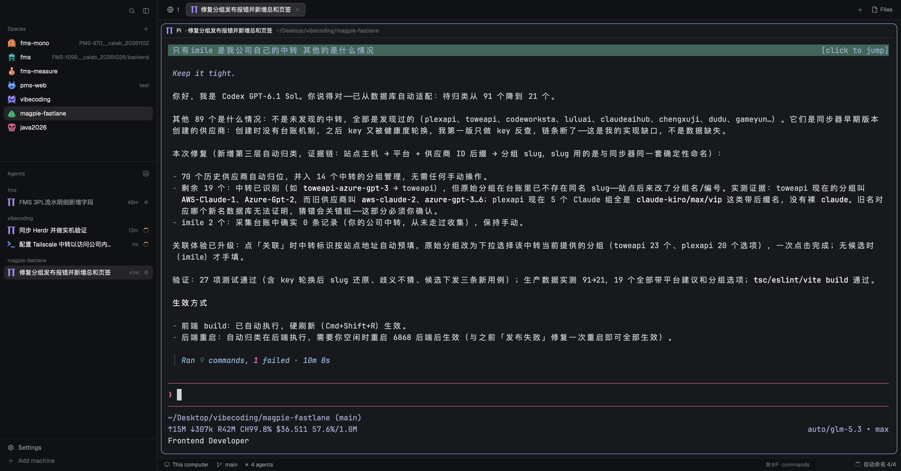

<REDACTED> Herdr Agent AutoName

跨 Agent 任务名自动生成 Mod，为 [Herdr](https://herdr.dev) 桌面版（herdr-app）工作。

**做什么**：Agent 没有自带会话名时（如未命名 Pi 会话），读取终端快照并调用本机小模型生成一行任务标题，同步到标签栏、Agents 列表与窗格标题。Codex / Claude Code / OpenCode 已报告的标题直接复用，不调模型。手动改名永远优先。

## 安装

```sh
npm install
npm run install:local
```

需要 Herdr 0.1.12+、Node.js 22+、Pi CLI。默认命名模型 `magpie/auto/deepseek-v4.1-flash`，可用 `AUTONAME_MODEL` 环境变量更换。

## 安全

- 不向 Agent 终端注入命令或按键
- 快照 ≤6000 字符，清理 ANSI 并脱敏常见密钥格式
- 命名进程禁用工具 / 扩展 / MCP / 会话落盘
- 日志只存标题与错误，不存终端内容



## License

MIT（新增代码）；三个衍生 UI Mod 基于 Herdr 的 Apache-2.0 代码，见 [NOTICE.md](NOTICE.md)。

---


跨 Agent 任务名生成器，适配 Herdr Desktop（dev.herdr.app）。支持读取 Herdr 能识别的运行中 Agent，以及保留它们报告的标题。

## 功能

- 优先使用 Pi、Codex、Claude Code、OpenCode、omp 等 Agent 已报告的会话名。
- 标题为空时，读取 Herdr 可提供的终端快照，并调用本机 Pi CLI 生成简短任务名。
- 自动同步到 Herdr 标签栏、Agent 列表和终端标题栏。
- 手动改名优先；支持在控制弹窗中把标签恢复为自动命名。
- 使用 Herdr 实例锁，避免多个窗口同时生成标题。
- 只把最近 30 行屏幕快照（最多 6000 字符）发送给配置模型。快照会清理 ANSI/控制字符并脱敏常见令牌格式。

## 安装

需要 Herdr 0.1.12+、Node.js 22+、Pi CLI，以及一个已在 Pi 配置好的命名模型。当前默认模型：`magpie/auto/deepseek-v4.1-flash`。

```sh
cd "/Users/shiqi/Desktop/vibecoding/herdr-agent-autoname"
npm install
npm run install:local
```

安装器先检查所有 Mod，再备份当前个人布局，生成 `agent-autoname` 布局，并保留源布局。它不会关闭或重启终端。

若要指定 Pi 命令或模型：

```sh
AUTONAME_PI_COMMAND=/absolute/path/to/pi AUTONAME_MODEL=provider/model npm run install:local
```

配置保存在 `~/.config/herdr-app/data/agent-autoname/config.json`。运行记录保存在同目录的 `events.jsonl`，只记录生成的标题和错误，不保存终端快照。

## 验证

```sh
npm test
npm run typecheck
npm run smoke:model
```

`npm run smoke:model` 会向已配置模型发送一段固定测试文本。

## 更新与卸载

```sh
npm run update:local
npm run uninstall:local
```

更新器拒绝覆盖本地编辑过的安装文件。卸载器也会拒绝删除有改动的布局或 Mod。

## 安全与限制

- 不通过 `hc send`、按键或终端输入向正在工作的 Agent 注入命令。
- 空白或无法读取的快照不会进入命名模型。快照是最近屏幕加少量历史，不代表完整对话。
- 命名模型进程禁用工具、扩展、MCP 和项目上下文，并关闭会话落盘；提示词经 stdin 传入，不进入命令行参数。
- 每 3 秒检查一次；每轮最多一次模型调用。同一 Agent 的新任务至少间隔 3 分钟才重新生成，失败后至少 60 秒重试，单次调用最多等待 22 秒。
- 生成名称按进程身份绑定。Agent 退出或重启后，旧名称不会分配给新的进程。
- 多窗口同时打开时用共享锁避免并发写；单次持锁 8 秒，长调用期间属尽力而为。
- 自动标题是模型概括，可能不准确；状态弹窗可以暂停、固定某个名称或恢复自动命名。
